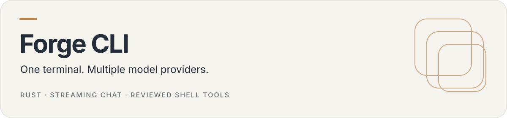

<p align="center">
  
</p>

# Forge CLI

A Rust command-line assistant with streaming chat, provider selection, file/repository context and locally saved sessions. Choose a configured remote provider, a local model endpoint or the mock provider.

[Quick start](#quick-start) · [Commands](#commands) · [Configuration](#configuration-and-data) · [Source map](#source-map)

## Features

| Capability  | Current implementation                                                         |
| ----------- | ------------------------------------------------------------------------------ |
| Providers   | Google, Grok, OpenRouter, local HTTP endpoint and mock adapters                |
| Context     | Attach selected files or a map of the current repository                       |
| Streaming   | Incremental responses in the terminal                                          |
| Shell tools | Proposed shell commands require an interactive confirmation; default is **No** |
| Sessions    | Chat sessions saved locally; `sessions` lists saved entries                    |

The crate is version `0.1.0`. Treat this as a development tool and review commands before execution; confirmation is not a filesystem or process sandbox.

## Quick start

Install a Rust toolchain with Cargo, then:

```sh
git clone https://github.com/coding-nyx/forge-cli.git
cd forge-cli
cargo run -- --help
cargo run -- chat --provider mock "Hello"
```

The mock adapter exercises the terminal workflow without a model-provider credential. To install the current package locally:

```sh
cargo install --path .
forge-cli --help
```

The executable is `forge-cli`; the Clap application name displayed in help is `forge`.

## Commands

```sh
cargo run -- setup
cargo run -- config
cargo run -- sessions
cargo run -- chat --provider local "Explain this project"
cargo run -- chat --provider mock --file Cargo.toml "Summarize the manifest"
```

`chat` also accepts `--model` and `--repo`. In an interactive chat, `/provider`, `/model`, `/models`, `/history` and `/help` control the current session; `exit` or `quit` leaves it.

## Configuration and data

`setup` configures providers and defaults interactively. Remote adapters also read `GOOGLE_API_KEY`, `GROK_API_KEY` or `OPENROUTER_API_KEY` from the process environment. The local endpoint defaults to `http://localhost:11434` and can be changed through setup.

Configuration is a TOML file in the platform configuration directory resolved by `directories::ProjectDirs`; `config` prints its location. Sessions are JSON files in the platform data directory. Credentials entered through setup are stored in the configuration file, rather than a dedicated secret vault. Protect those files and exclude them from source control.

Selected context and conversation messages go to the chosen provider. A local-first configuration does not make remote-provider requests stay on the computer. Shell execution uses the current process's permissions.

## Development

```sh
cargo check
cargo test
cargo build --release
```

These are contributor commands, not a claim of a current passing CI run.

## Source map

| Path                  | Responsibility                                 |
| --------------------- | ---------------------------------------------- |
| `src/cli.rs`          | Commands and arguments                         |
| `src/config.rs`       | Provider/default configuration                 |
| `src/context.rs`      | File and repository context                    |
| `src/providers/`      | Provider adapters and model discovery          |
| `src/orchestrator.rs` | Streaming loop, commands and tool confirmation |
| `src/session.rs`      | Session persistence                            |
| `src/tools/`          | Shell tool implementation                      |

No top-level license file is present; no new license grant is implied by this README.
